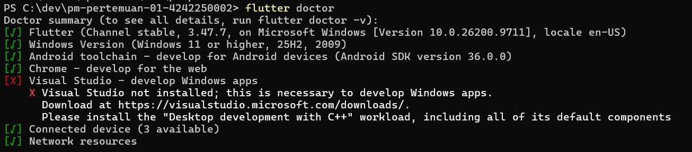
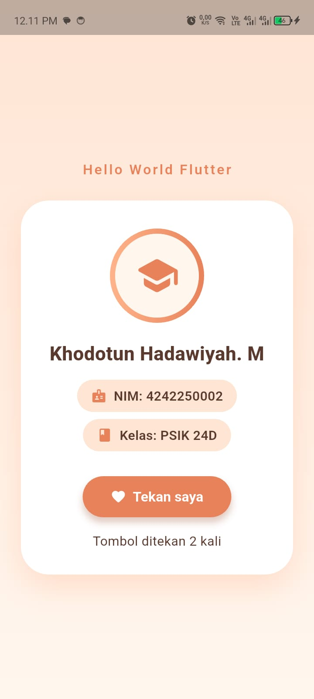

# Tugas Rutin 1: Setup Environment & Aplikasi Hello World Flutter

Mata kuliah Pemrograman Mobile, Pertemuan 1.

## a. Identitas
- **Nama:** Khodotun Hadawiyah. M
- **NIM:** 4242250002
- **Kelas:** PSIK 24D

## b. Keluaran `flutter --version`
```
TEMPEL hasil flutter --version di sini
```

## c. Tangkapan layar `flutter doctor`


Catatan: tanda [X] pada Visual Studio dapat diabaikan karena hanya dibutuhkan untuk aplikasi desktop Windows.

## d. Tangkapan layar aplikasi berjalan
Aplikasi dijalankan di perangkat fisik **Infinix SMART 9 (Android 14)**.



Aplikasi menampilkan nama, NIM, kelas, serta widget tambahan `Icon` dan `ElevatedButton` (penghitung klik dengan `setState`).

## e. Kendala dan solusi

| No | Kendala | Solusi |
|----|---------|--------|
| 1 | `'flutter' is not recognized` saat menjalankan `flutter --version` | PATH belum memuat `C:\dev\flutter\bin`. Menambahkannya ke Environment Variables, lalu menutup dan membuka ulang terminal. |
| 2 | `cmdline-tools component is missing` dan lokasi Android SDK kosong di Settings | Mengisi Android SDK Location dengan `C:\Users\Hp\AppData\Local\Android\Sdk`, lalu memasang Command-line Tools lewat SDK Manager. |
| 3 | `No valid Android SDK platforms found` | Folder Build-Tools kosong. Memasang ulang Android SDK Build-Tools 36.0.0 lewat SDK Manager. |
| 4 | HP tidak terdeteksi (`adb devices` kosong) | Mengaktifkan Opsi pengembang (ketuk Nomor bentukan 7 kali), mengaktifkan USB debugging, memakai kabel data, dan menyetujui izin debugging USB. |
| 5 | `Android sdkmanager did not install NDK 28.2.13676358` saat build | Memasang NDK versi tersebut secara manual lewat SDK Manager, lalu menjalankan ulang `flutter run`. |
| 6 | Unduhan System Image emulator `Read timed out` | Koneksi tidak stabil dan RAM laptop terbatas, sehingga beralih memakai HP fisik. |

## f. Esai: Native, Hybrid, dan Cross-platform

Native adalah pendekatan pengembangan aplikasi yang dibuat khusus untuk satu sistem operasi, yaitu Kotlin atau Java untuk Android dan Swift untuk iOS. Kelebihannya adalah performa aplikasi lebih optimal dan dapat memanfaatkan fitur perangkat secara maksimal. Namun, jika ingin tersedia di Android dan iOS, pengembang perlu membuat aplikasi secara terpisah. Contoh kasusnya adalah aplikasi mobile banking yang membutuhkan keamanan tinggi, performa stabil, serta akses ke fitur keamanan perangkat.

Hybrid menggabungkan teknologi web seperti HTML, CSS, dan JavaScript dengan pembungkus aplikasi mobile yang dijalankan melalui WebView. Kelebihannya, pengembangan lebih hemat biaya dan mudah bagi pengembang web. Kekurangannya, performa dan pengalaman pengguna kurang optimal untuk fitur yang kompleks. Contohnya adalah aplikasi katalog produk toko yang menampilkan daftar barang, harga, dan promosi.

Berbeda dengan Hybrid, Cross-platform memungkinkan pengembang membuat aplikasi Android dan iOS dari satu basis kode menggunakan framework seperti Flutter atau React Native, dan Flutter menggambar tampilannya sendiri melalui engine, bukan WebView. Pendekatan ini menghemat waktu pengembangan. Kekurangannya, performa pada komputasi berat bisa kurang maksimal dibandingkan Native, dan beberapa fitur perangkat memerlukan tambahan kode Native. Contohnya adalah aplikasi pemesanan makanan yang tersedia di Android dan iOS dengan fitur pemesanan, pembayaran, dan pelacakan pesanan.

## g. Pernyataan penggunaan AI
Saya menggunakan Claude (Anthropic) sebagai asisten untuk memandu instalasi dan pemecahan galat environment, membantu menyusun kode tampilan aplikasi, serta merapikan kerangka README dan esai. Seluruh langkah dijalankan sendiri di laptop dan perangkat saya, dan isi esai berasal dari ringkasan yang saya tulis sendiri.